# Panel Administrator TKBJ — Dashboard Web

Prototipe **Dashboard Web untuk administrator** Taman Krida Budaya Jawa Timur (TKBJ), dibuat untuk tugas Ujian Tengah Semester (UTS).

TKBJ adalah pusat seni dan budaya Jawa Timur di Kota Malang. Sistem ini terdiri dari dua antarmuka:

- **Dashboard Web (repository ini):** dipakai admin untuk mengelola acara, tiket pertunjukan, sewa gedung, pembayaran, konten, dan komunitas seni.
- **Mobile Application:** dipakai pengunjung untuk melihat agenda, membeli tiket, dan mengajukan sewa gedung.

Desain antarmuka mengikuti rancangan Figma tim. Seluruh data adalah **data contoh (dummy)**. Tidak ada database: data acara dan sesi login disimpan di `localStorage` browser.

---

## Pemenuhan ketentuan UTS

| Ketentuan | Implementasi |
|---|---|
| Halaman login (simulasi) | `/login`: validasi username/password, pesan error, akun demo. Halaman admin terkunci sebelum login. Ada tombol **Keluar** di menu akun. |
| Dashboard utama | `/`: ringkasan metrik, agenda terdekat, antrean tugas, transaksi terbaru, log aktivitas. |
| Tampilan data tabel / kartu | Tabel pesanan, kartu metrik, kartu inventori tiket, kartu galeri, dan lainnya di setiap halaman. |
| Halaman pengelolaan data | **Acara & kalender** (`/acara`): **tambah, edit, hapus**, terbitkan/tarik publikasi, cari, filter, dan paginasi. Data tersimpan di `localStorage`. |
| Navigasi antarhalaman | Sidebar dengan 11 halaman, breadcrumb, dan tautan antarbagian (mis. "Kelola kalender →"). |
| Form menerima input + validasi | Login (wajib isi, format username, minimal 6 karakter, akun salah). Form acara (wajib isi, nama minimal 3 karakter, nama duplikat di tanggal yang sama, jam selesai harus setelah jam mulai, kuota bilangan bulat ≥ 0). Form inventori tiket (kuota tidak boleh kurang dari tiket terjual). |
| Data dummy / penyimpanan lokal | `src/data/*.js` berisi data contoh. Acara dan sesi login disimpan di `localStorage`. Ada tombol **Pulihkan data contoh**. |
| Rancangan fitur AI | Lihat bagian [Rancangan Fitur AI](#rancangan-fitur-ai). Pratinjaunya juga tampil di halaman Transaksi. |

---

## Akun demo

| Username | Password | Peran |
|---|---|---|
| `admin` | `admin123` | Administrator utama |
| `keuangan` | `keuangan123` | Admin Keuangan |

Klik salah satu akun demo di halaman login untuk mengisi form secara otomatis.

---

## Panduan menjalankan aplikasi

Prasyarat: **Node.js 20 atau lebih baru** (diuji dengan Node 24) dan npm.

```bash
# 1. Clone repository lalu masuk ke folder dashboard
git clone <url-repository-ini>
cd <nama-folder>/admin-dashboard

# 2. Pasang dependensi
npm install

# 3. Jalankan mode pengembangan
npm run dev
```

Buka http://localhost:3000, lalu login memakai akun demo.

### Build produksi

```bash
npm run build     # hasil di folder .next/
npm run start     # menjalankan hasil build di http://localhost:3000
```

Semua halaman di-*prerender* sebagai halaman statis oleh Next.js. Cara termudah untuk online adalah mengimpor repository ini ke [Vercel](https://vercel.com) (pilih folder `admin-dashboard` sebagai *Root Directory*).

---

## Library / package yang digunakan

| Package | Versi | Kegunaan |
|---|---|---|
| [next](https://nextjs.org) | 16.4.0 | Framework React: routing berbasis folder (App Router), build, dev server, optimasi gambar dan font |
| [react](https://react.dev) | 19.3.0 | Library UI berbasis komponen |
| react-dom | 19.3.0 | Render React ke browser |
| [lucide-react](https://lucide.dev) | 1.52.0 | Ikon, sama dengan ikon pada desain Figma |
| [oxlint](https://oxc.rs) | 1.87.0 | Linter (`npm run lint`), dengan plugin aturan Next.js |

Font Inter, Playfair Display, dan Poppins dimuat lewat `next/font/google`. Foto memakai `next/image`. Styling memakai CSS biasa dengan design token (`src/index.css`), tanpa framework CSS.

---

## Screenshot

| Login | Validasi login |
|---|---|
| 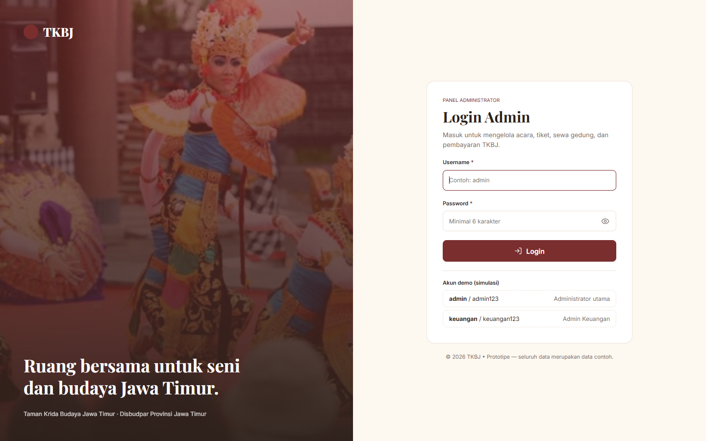 | 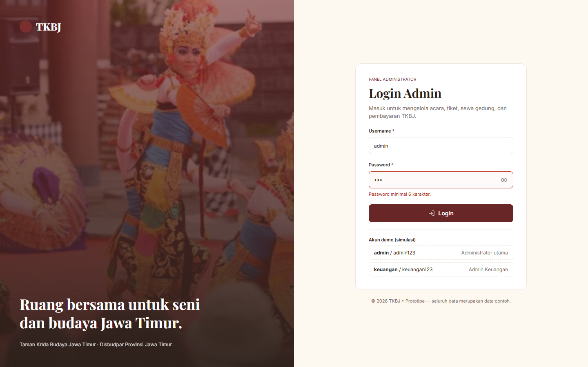 |

**Dashboard utama**

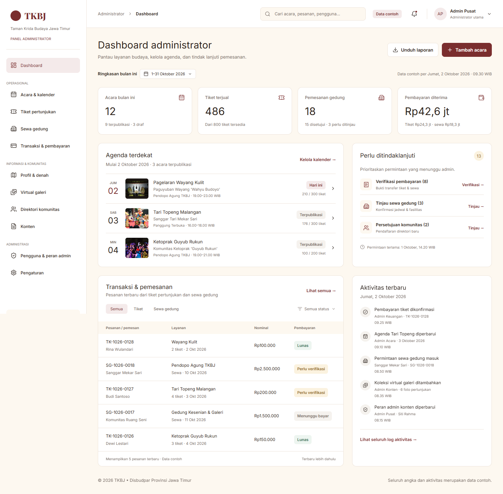

**Pengelolaan data acara (tambah, edit, hapus)**

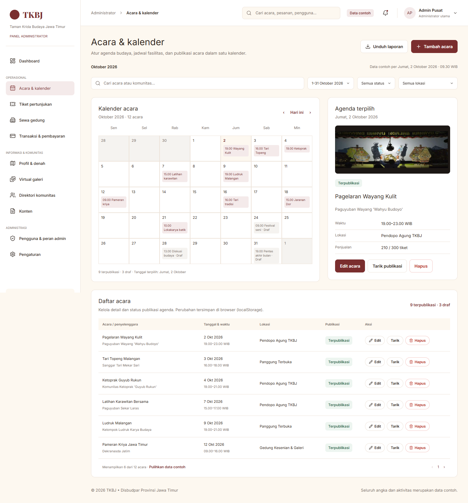

| Validasi form tambah acara | Konfirmasi hapus |
|---|---|
| 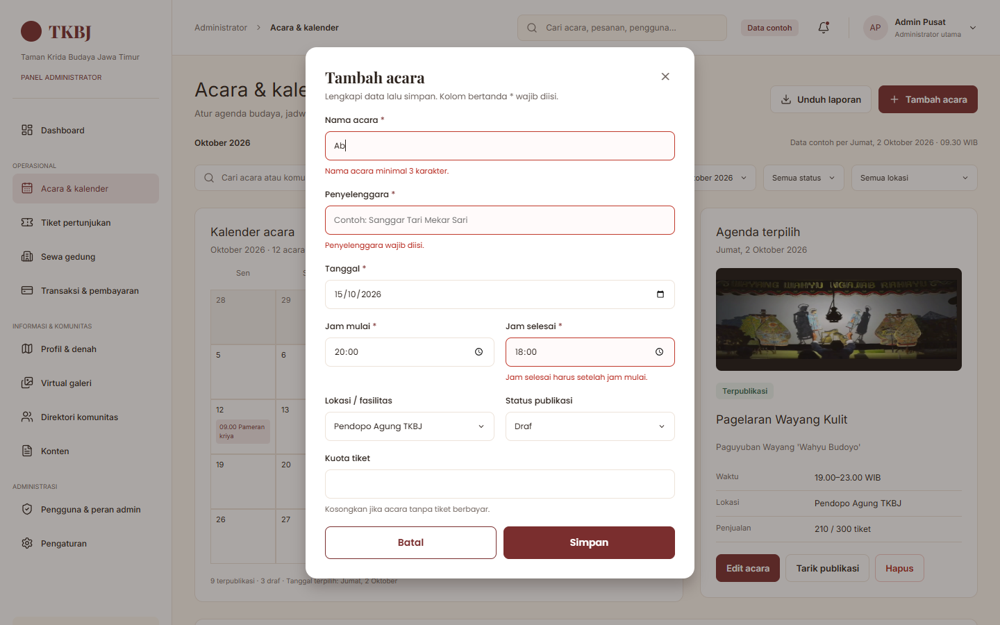 | 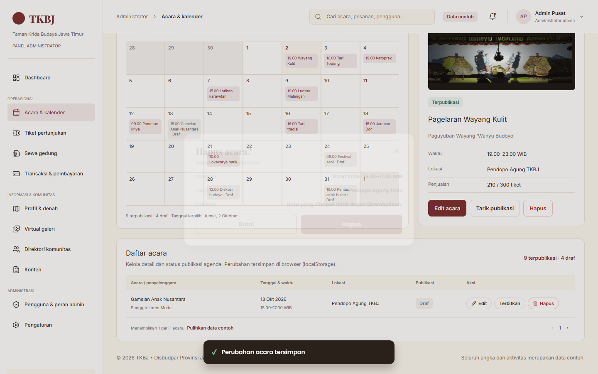 |

**Transaksi & pembayaran, dengan pratinjau rancangan fitur AI**

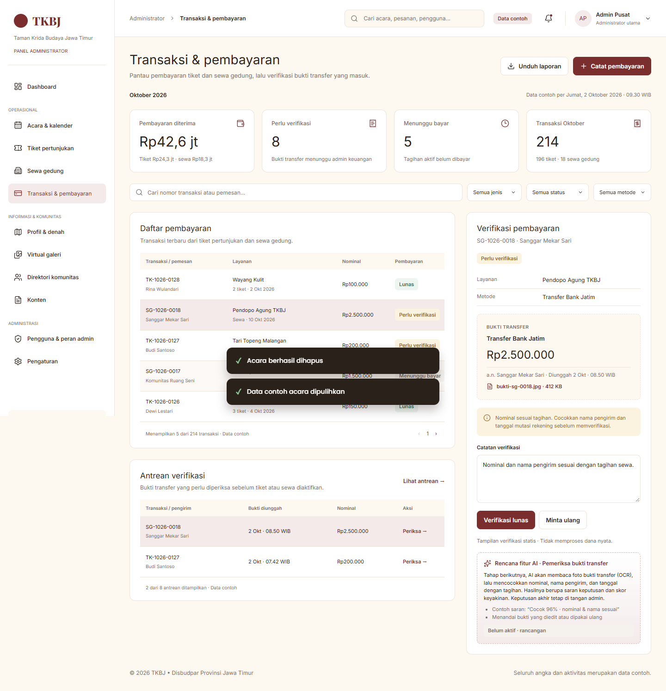

<details>
<summary>Screenshot halaman lain</summary>

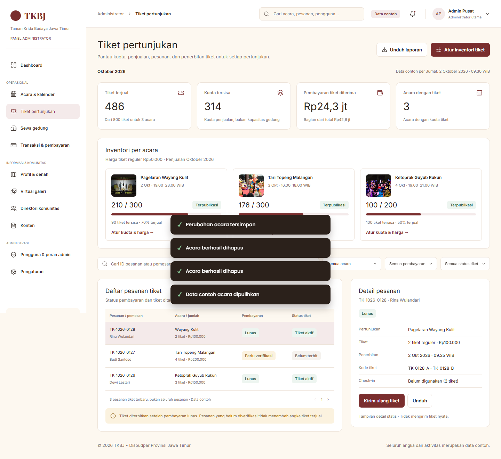
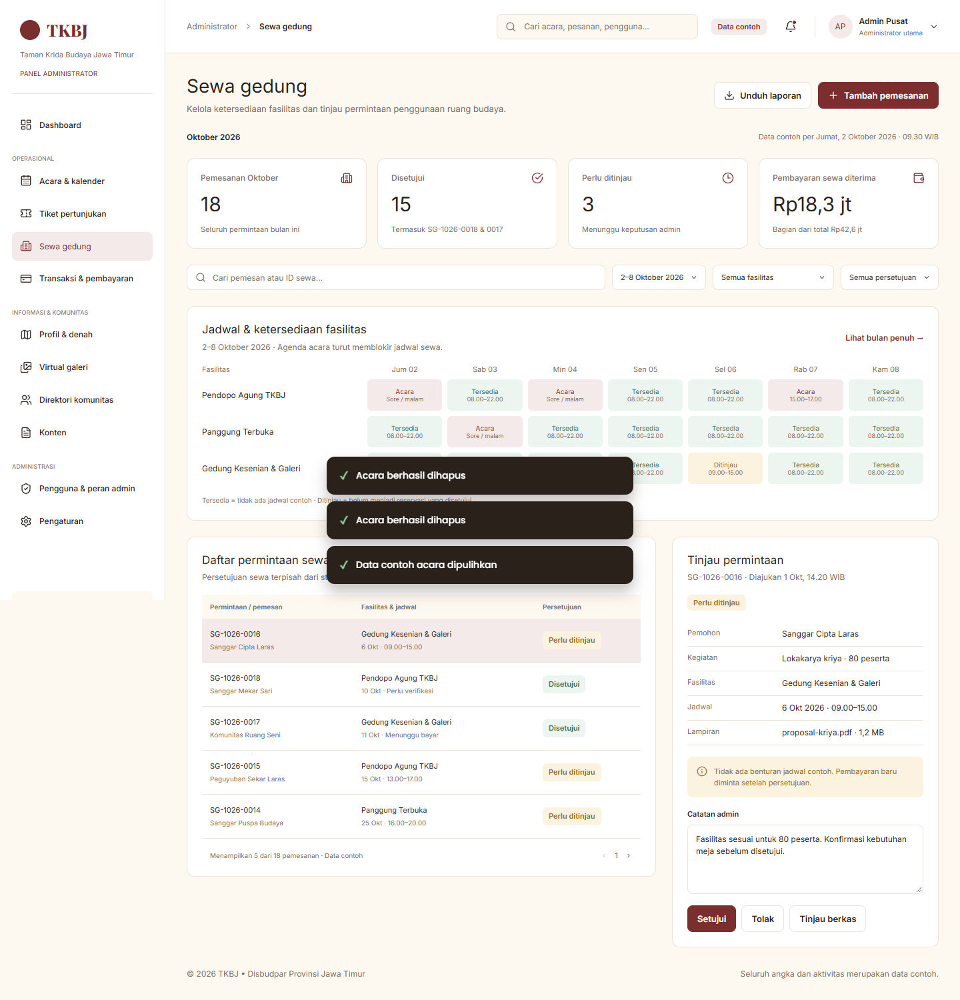
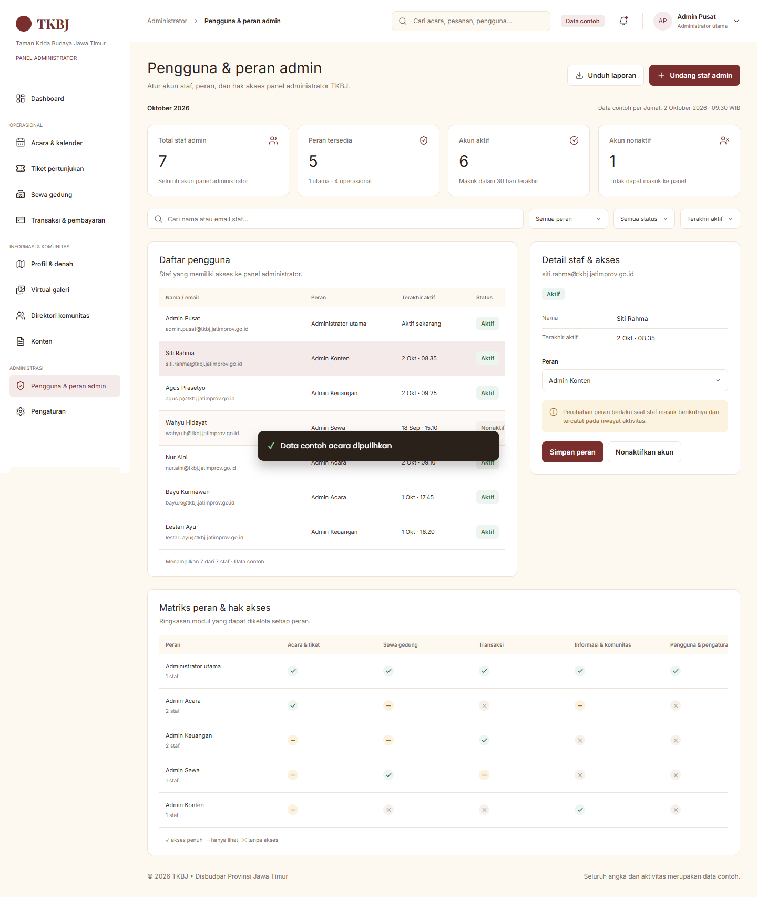

**Tampilan mobile (390px)**

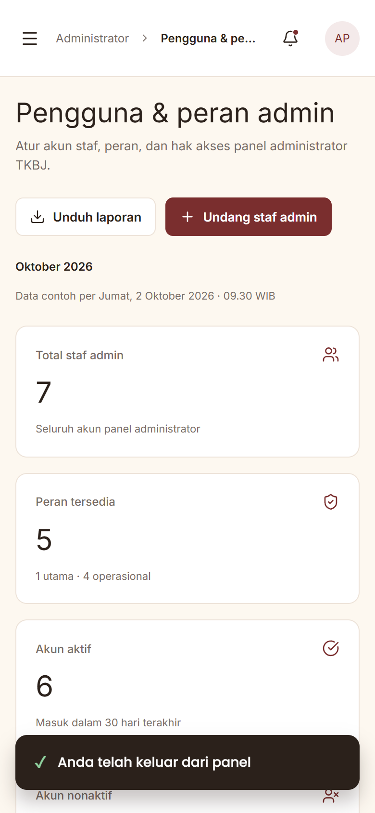

</details>

---

## Daftar halaman

| Rute | Halaman | Isi utama |
|---|---|---|
| `/login` | Login | Login simulasi dengan validasi |
| `/` | Dashboard | Metrik, agenda, antrean tindak lanjut, transaksi, aktivitas |
| `/acara` | Acara & kalender | **CRUD acara**, kalender bulanan, filter |
| `/tiket` | Tiket pertunjukan | Inventori tiket per acara, pesanan, verifikasi |
| `/sewa` | Sewa gedung | Jadwal ketersediaan fasilitas, tinjau permintaan sewa |
| `/transaksi` | Transaksi & pembayaran | Daftar pembayaran, antrean verifikasi, rancangan AI |
| `/profil` | Profil & denah | Editor profil dengan pratinjau langsung, denah area |
| `/galeri` | Virtual galeri | Koleksi media, metadata, unggahan |
| `/komunitas` | Direktori komunitas | Daftar komunitas, persetujuan pendaftaran |
| `/konten` | Konten | Daftar konten, editor banner beranda |
| `/pengguna` | Pengguna & peran admin | Akun staf, matriks hak akses |
| `/pengaturan` | Pengaturan | Notifikasi, pemesanan, pembayaran, keamanan |

---

## Rancangan Fitur AI

> Fitur ini **belum diimplementasikan**. Bagian ini menjelaskan rencana pengembangan tahap berikutnya.

### Asisten Verifikasi Bukti Pembayaran

**Masalah.** Pembayaran tiket dan sewa gedung dilakukan lewat transfer bank. Admin keuangan harus mencocokkan setiap foto bukti transfer dengan tagihan secara manual: nominal, nama pengirim, dan tanggal. Pada data contoh ada **8 pembayaran** yang menunggu verifikasi. Proses ini lambat dan rawan salah, sementara tiket baru terbit setelah pembayaran dinyatakan lunas.

**Solusi.** AI membaca foto bukti transfer yang diunggah pengguna dari Mobile App, lalu memberi **saran keputusan** kepada admin.

**Alur kerja:**

1. Pengguna mengunggah foto bukti transfer di Mobile App.
2. **OCR / vision model** mengekstrak teks: nama bank, nominal, nama pengirim, tanggal dan jam, nomor referensi.
3. **Pencocokan aturan** membandingkan hasil ekstraksi dengan tagihan (nomor pesanan, nominal, nama pemesan, batas waktu bayar).
4. **Deteksi anomali** menandai bukti yang dicurigai diedit, bukti yang sama dipakai ulang (hash gambar), atau nominal yang tidak wajar.
5. Dashboard menampilkan **skor keyakinan** dan alasannya, misalnya *"Cocok 96% · nominal & nama sesuai"* atau *"Perlu dicek: tanggal transfer melewati batas bayar"*.
6. Admin tetap mengambil **keputusan akhir** (Verifikasi lunas / Minta ulang). Keputusan admin menjadi data latih untuk perbaikan model.

**Input dan output:**

| Input | Output |
|---|---|
| Foto bukti transfer (JPG/PNG/PDF) | Data terstruktur: bank, nominal, pengirim, tanggal, no. referensi |
| Data tagihan dari sistem | Status saran: *Cocok* / *Perlu dicek* / *Tidak cocok* |
| Riwayat bukti sebelumnya | Skor keyakinan 0–100% beserta alasan |

**Rencana teknologi:** layanan OCR atau vision-language model (misalnya model multimodal melalui API) dan backend sederhana (Node.js/Express atau Firebase Functions) sebagai penghubung. Aturan pencocokan ditulis sebagai kode biasa agar mudah diaudit.

**Manfaat:** mempercepat antrean verifikasi, mengurangi salah input, tiket lebih cepat terbit, dan ada jejak alasan untuk setiap keputusan.

**Batasan dan etika:** AI hanya memberi saran, bukan keputusan otomatis. Data bukti transfer bersifat pribadi, jadi disimpan terbatas dan aksesnya dibatasi untuk Admin Keuangan sesuai matriks peran.

Pratinjau tampilannya ada di halaman **Transaksi & pembayaran**, pada panel "Verifikasi pembayaran".

---

## Struktur proyek

```
├── docs/screenshots/      screenshot untuk README
├── public/                favicon dan logo
├── src/
│   ├── app/               rute Next.js (App Router)
│   │   ├── layout.jsx     layout root: font, metadata, provider modal/toast
│   │   ├── not-found.jsx  rute tak dikenal → dialihkan ke Dashboard
│   │   ├── login/         halaman /login
│   │   └── (admin)/       halaman admin; layout.jsx = proteksi login + sidebar/topbar
│   │       ├── page.jsx   /  (Dashboard)
│   │       ├── acara/     /acara
│   │       └── …          /tiket, /sewa, /transaksi, /profil, dst.
│   ├── assets/            foto dari desain Figma (diimpor untuk next/image)
│   ├── index.css          design token & gaya seluruh komponen
│   ├── components/
│   │   ├── Layout.jsx     sidebar, topbar, menu akun (logout)
│   │   ├── RequireAuth.jsx  mengalihkan ke /login jika belum login
│   │   ├── ui.jsx         komponen dasar: Badge, Card, DataTable, Field, dll.
│   │   └── overlay.jsx    modal form (dengan validasi), modal detail, toast
│   ├── data/
│   │   ├── auth.js        login simulasi + sesi (localStorage)
│   │   ├── events.js      data acara, validasi, dan store CRUD (localStorage)
│   │   └── sample.js      data contoh lain (pesanan, foto)
│   └── views/             isi tiap halaman (Login, Dashboard, Acara, …), dipakai oleh src/app
└── next.config.mjs
```

`src/app/**/page.jsx` adalah *server component* tipis yang mengatur judul tab (`metadata`) lalu merender komponen dari `src/views/`. Komponen di `src/views/` dan `src/components/` adalah *client component* (`'use client'`) karena memakai state, event, dan `localStorage`. Folder isi halaman sengaja dinamai `views/`, bukan `pages/`, karena `src/pages/` dicadangkan Next.js untuk Pages Router.

## Catatan

- Data contoh mengacu pada periode **Oktober 2026**, sesuai desain.
- Selain halaman Acara, aksi di halaman lain (setujui/tolak, verifikasi, aktif/nonaktif) mengubah status di layar sebagai simulasi. Perubahan itu kembali ke awal saat halaman dimuat ulang.
- Untuk mengembalikan data acara ke kondisi awal, klik **Pulihkan data contoh** di bawah tabel *Daftar acara*.
