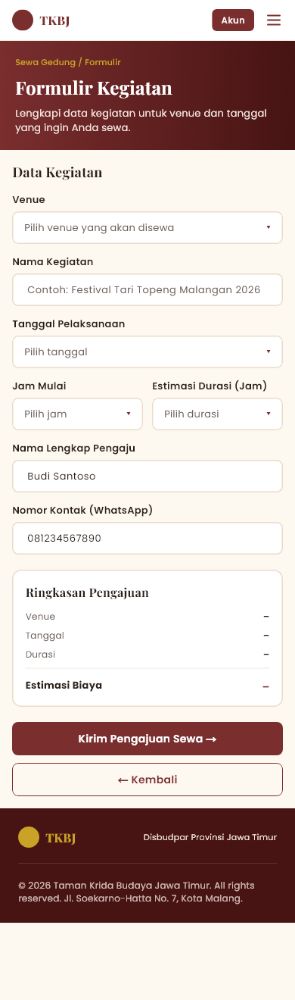
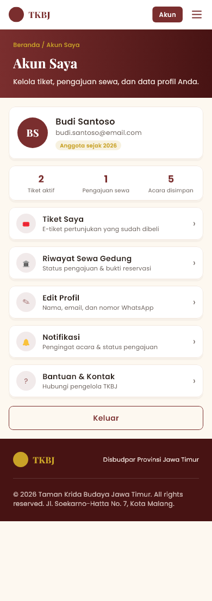
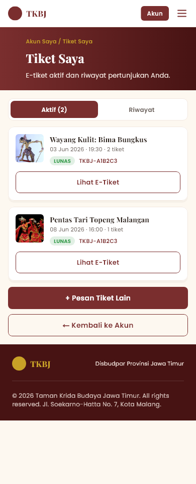
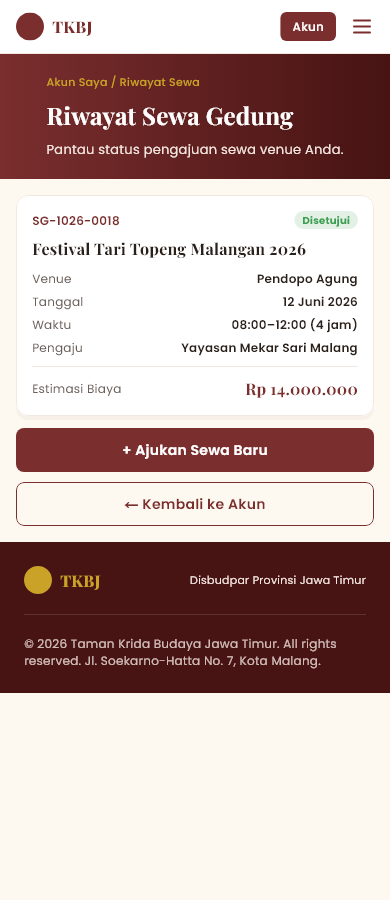

# TKBJ Mobile — Aplikasi Pengunjung

Prototipe **Mobile Application untuk pengguna akhir** Taman Krida Budaya Jawa Timur (TKBJ), dibuat dengan **Flutter** untuk tugas Ujian Tengah Semester (UTS).

Aplikasi ini adalah pasangan dari [Dashboard Web admin](../admin-dashboard) dalam satu rancangan sistem. Pengunjung dapat melihat profil & denah TKBJ, menjelajah kalender acara, memesan tiket pertunjukan sampai pembayaran (simulasi), mengajukan sewa gedung, dan melihat tiket serta riwayat sewa di akun mereka.

Tampilan mengikuti desain Figma tim (halaman **mobile**, frame 390 px). Seluruh data adalah **data contoh (dummy)** di memori, tanpa database.

---

## Pemenuhan ketentuan UTS

| Ketentuan | Implementasi |
|---|---|
| Halaman login (simulasi) | `LoginScreen`: validasi email & kata sandi, pesan "email belum terdaftar" / "kata sandi salah", tombol isi akun demo. Halaman **Daftar Akun** juga tersedia. |
| Halaman utama | `HomeScreen`: hero, tentang TKBJ, 7 kartu fitur utama. |
| Form input | Login, Daftar Akun, **Data Pemesan** (checkout), **Formulir Sewa Gedung**, Edit Profil. |
| Halaman yang menampilkan data / hasil input | Kalender & detail acara, **E-Tiket** setelah bayar, **Tiket Saya**, **Riwayat Sewa Gedung**, Akun Saya. Data yang diisi di form langsung muncul di halaman ini. |
| Navigasi antarhalaman | 18 rute bernama (`lib/routes/app_routes.dart`), menu navigasi layar penuh, breadcrumb, rute akun yang dilindungi login (otomatis diarahkan ke halaman Masuk). |
| Validasi sederhana | Wajib isi, format email, nomor WhatsApp `08…` 10–13 digit, kata sandi ≥ 8 karakter, persetujuan ketentuan, keranjang tidak boleh kosong, jumlah tiket 0–4, **jadwal venue bentrok**, **jam sewa melewati 22:00**. |
| Data dummy | `lib/data/dummy/dummy_data.dart` (acara, fasilitas, akun, pesanan & sewa awal). |
| Rancangan AI | Lihat [Rancangan Fitur AI](#rancangan-fitur-ai). |

### Akun demo

| Email | Kata sandi |
|---|---|
| `budi.santoso@email.com` | `tkbj2026` |

Tekan **Pakai** pada kotak akun demo di halaman Masuk untuk mengisi form otomatis. Akun baru dari halaman Daftar juga bisa dipakai selama aplikasi berjalan.

---

## Panduan menjalankan aplikasi

Prasyarat: **Flutter 3.x** (diuji dengan Flutter 3.47.1 / Dart 3.13), serta emulator Android, perangkat Android, atau Chrome.

```bash
# 1. Clone repository lalu masuk ke folder aplikasi mobile
git clone <url-repository-ini>
cd <nama-folder>/mobile-app

# 2. Pasang dependensi
flutter pub get

# 3. Jalankan (pilih perangkat yang tersedia)
flutter run            # emulator / HP Android
flutter run -d chrome  # atau di browser
```

### Build

```bash
flutter build apk --release   # hasil: build/app/outputs/flutter-apk/app-release.apk
flutter build web             # hasil: build/web/
```

### Pengujian

```bash
flutter analyze   # analisis statis (lint)
flutter test      # 75 test: unit, alur login & checkout, responsif 4 ukuran layar
```

`test/responsive_test.dart` merender **17 layar** pada 4 ukuran (320×568, 430×932, landscape 844×390, tablet 1024×768) dan gagal jika ada *overflow*.

Screenshot di bawah dibuat otomatis dengan:

```bash
flutter test test_screenshots --update-goldens
```

---

## Library / package yang digunakan

| Package | Versi | Kegunaan |
|---|---|---|
| [flutter](https://flutter.dev) (SDK) | 3.47.1 | Framework UI |
| [flutter_svg](https://pub.dev/packages/flutter_svg) | 2.3.0 | Menampilkan ikon & logo SVG hasil ekspor Figma |
| flutter_test (SDK, dev) | — | Unit test & widget test |
| [flutter_lints](https://pub.dev/packages/flutter_lints) (dev) | 6.0.0 | Aturan lint |

**Aset**

| Aset | Sumber |
|---|---|
| Ikon SVG (`assets/icons/`) dan foto (`assets/images/`) | Diekspor dari desain Figma |
| Font Poppins & Playfair Display | Google Fonts (OFL), dibundel agar tampil sama tanpa internet |
| `TkbjSymbolsMath.ttf`, `TkbjSymbols2.ttf` | Subset Noto Sans Math & Noto Sans Symbols 2 (OFL), hanya berisi simbol desain: ◆ ◇ ◈ ◉ ▣ ✦ ❖ ✓ → ← ✎ ▾ |

State management memakai `ChangeNotifier` + `InheritedNotifier` bawaan Flutter (tanpa package tambahan).

---

## Screenshot

| Beranda | Menu navigasi | Masuk | Daftar akun |
|---|---|---|---|
|  |  |  |  |

| Profil & denah | Kalender acara | Detail acara | Pesan tiket |
|---|---|---|---|
|  |  |  |  |

| Checkout 1: data pemesan | Checkout 2: metode bayar | Checkout 3: konfirmasi QRIS | Checkout 4: e-tiket |
|---|---|---|---|
|  |  |  |  |

| Formulir sewa gedung | Akun saya | Tiket saya | Riwayat sewa |
|---|---|---|---|
|  |  |  |  |

---

## Alur utama

1. **Pesan tiket:** Beranda → Kalender Acara → Detail Acara → *"Ingin memesan tiket?"* → Pesan Tiket (stepper 0–4) → Data Pemesan → Metode Bayar (QRIS / Virtual Account / E-Wallet) → Konfirmasi → **E-Tiket + kode booking** → Tiket Saya.
2. **Sewa gedung:** Profil & Denah (pin peta / kartu fasilitas) atau menu Sewa Gedung → Formulir Kegiatan (venue, tanggal, jam, durasi, ringkasan biaya otomatis) → *Pengajuan terkirim* → Riwayat Sewa.
3. **Akun:** Masuk / Daftar → Akun Saya → Tiket Saya, Riwayat Sewa, Edit Profil, Keluar.

Fitur **Virtual Galeri, Direktori Komunitas, Edukasi Budaya,** dan **Notifikasi** sudah dirancang di Figma, tetapi pada tahap UTS ini baru tampil sebagai halaman "Segera Hadir".

---

## Responsif

- Navbar tetap di atas; isi dan footer berada di dalam `SingleChildScrollView`, jadi tidak ada *bottom overflow* di ponsel kecil atau saat landscape.
- `ContentSection` membatasi lebar konten maksimal 720 px dan menaruhnya di tengah pada tablet/landscape, sementara latar section tetap selebar layar.
- `ResponsiveGrid` (berbasis `LayoutBuilder`) menyusun kartu 1 kolom di ponsel, 2–3 kolom di layar lebar.
- Pin peta denah memakai posisi relatif (0–1) terhadap ukuran peta, sehingga tetap di titik yang sama di semua lebar layar.
- Teks panjang memakai `Expanded`/`Flexible`, `maxLines` + ellipsis, dan `Wrap`.

---

## Rancangan Fitur AI

> Fitur ini **belum diimplementasikan**. Ini rencana pengembangan tahap berikutnya dan merupakan fitur AI yang sama dengan yang dijelaskan di [README Dashboard Web](../admin-dashboard/README.md#rancangan-fitur-ai).

### Asisten Verifikasi Bukti Pembayaran (sisi aplikasi mobile)

Pembayaran tiket dan sewa gedung lewat transfer bank harus dicocokkan admin secara manual dengan tagihan. Dengan AI, prosesnya menjadi:

1. Di layar konfirmasi pembayaran, pengguna **mengunggah foto bukti transfer** (kamera atau galeri).
2. Aplikasi mengirim foto ke backend. **OCR / vision model** membaca bank, nominal, nama pengirim, tanggal, dan nomor referensi.
3. Sistem mencocokkan hasilnya dengan tagihan (kode booking, total, nama pemesan) dan mendeteksi anomali, misalnya bukti dipakai ulang atau nominal tidak sesuai.
4. Pengguna langsung melihat status di **Tiket Saya / Riwayat Sewa**: *"Sedang diverifikasi"*, *"Lunas"*, atau *"Perlu unggah ulang: nominal tidak sesuai"*.
5. Admin di Dashboard Web melihat saran AI beserta skor keyakinannya dan tetap memegang **keputusan akhir**.

| Input (dari aplikasi) | Output (ke pengguna) |
|---|---|
| Foto bukti transfer + kode booking | Status verifikasi dan alasan singkat |
| Data tagihan pesanan | E-tiket terbit lebih cepat setelah dinyatakan lunas |

**Rencana teknologi:** `image_picker` di Flutter untuk mengambil foto, backend (Firebase Functions / Node.js) sebagai perantara ke layanan OCR atau model multimodal melalui API, dan notifikasi push saat status berubah.

**Etika & privasi:** AI hanya memberi saran. Foto bukti transfer disimpan terbatas dan hanya bisa diakses Admin Keuangan.

---

## Struktur proyek

```
mobile-app/
├── assets/
│   ├── fonts/        Poppins, Playfair Display, subset simbol Noto
│   ├── icons/        ikon & logo SVG dari Figma
│   └── images/       foto acara & fasilitas dari Figma
├── lib/
│   ├── main.dart                 entry point
│   ├── app.dart                  MaterialApp + AppStateScope
│   ├── core/
│   │   ├── constants/            path aset
│   │   ├── theme/                token warna, gaya teks, ThemeData
│   │   └── utils/                formatter rupiah/tanggal, validator, breakpoint
│   ├── data/
│   │   ├── models/               CulturalEvent, Facility, TicketOrder, RentalRequest, UserAccount
│   │   └── dummy/                data contoh
│   ├── state/app_state.dart      sesi login, keranjang, pesanan, pengajuan sewa
│   ├── routes/app_routes.dart    nama rute, router, proteksi login
│   ├── widgets/                  komponen global yang dipakai ulang
│   │   ├── layout/               TkbjScaffold, navbar, footer, PageHeader, ContentSection, ResponsiveGrid
│   │   ├── common/               AppButton, AppCard, PillBadge, InfoRow, bottom sheet & toast
│   │   ├── form/                 LabeledTextField, PickerField, AppCheckbox
│   │   └── interactive/          ChipFilter, QtyStepper, StepTracker (komponen interaktif Figma)
│   └── screens/                  satu folder per fitur, widget khusus fitur di subfolder widgets/
│       ├── home/  menu/  auth/  profile/  events/  tickets/
│       ├── checkout/  rental/  account/  coming_soon/
├── test/                         unit, widget, dan responsive test
└── test_screenshots/             generator screenshot README
```

## Catatan

- Status bar dan *home indicator* pada frame Figma adalah bingkai perangkat, sehingga tidak digambar ulang; aplikasi memakai status bar asli sistem operasi.
- Pembayaran adalah **simulasi**. Kode QR di layar konfirmasi adalah gambar tiruan, bukan QRIS sungguhan.
- Data tersimpan di memori dan kembali ke data contoh saat aplikasi ditutup.
